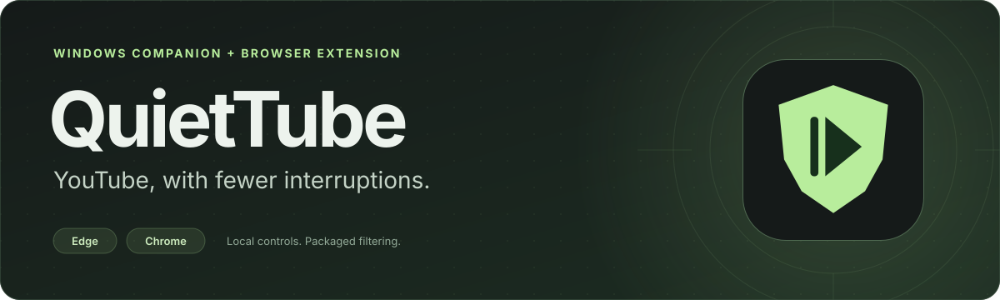
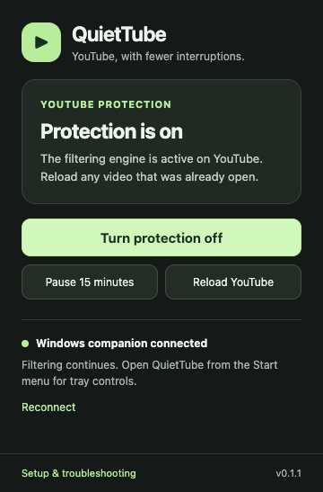
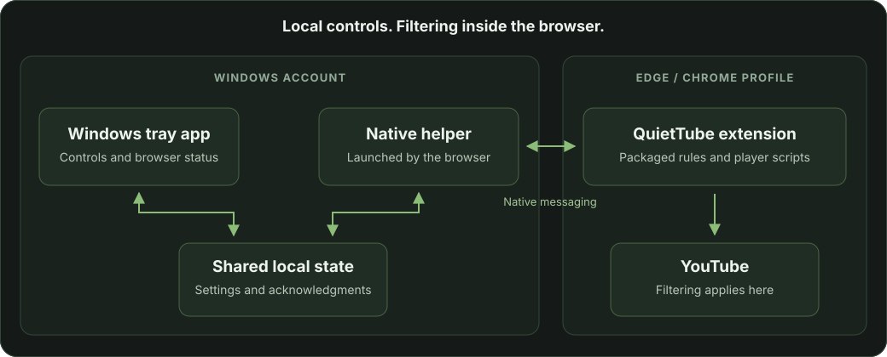

<div align="center">



**Keep the video. Quiet the interruptions.**

**[Download the Windows installer](https://github.com/ronniekai999/QuietTube/releases/download/v0.1.1/QuietTube-Windows-x64-0.1.1.zip)** · [SHA-256 checksum](https://github.com/ronniekai999/QuietTube/releases/download/v0.1.1/QuietTube-Windows-x64-0.1.1.zip.sha256)

<br>


<br>

[Get started](#get-started) · [Features](#features) · [Controls](#controls) · [Privacy](#privacy) · [Troubleshooting](#troubleshooting) · [Validation](#validation) · [Development](#development)

</div>

---

QuietTube pairs a native Windows tray app with a YouTube-focused browser extension. Watch in **Edge or Chrome**, turn protection on or off from either side, and take a 15-minute break when you need one. Connected browser profiles share the same choice.

The extension builds on **[uBlock Origin Lite](https://github.com/uBlockOrigin/uBOL-home)**, by Raymond Hill and contributors, with packaged network filters and YouTube player scriptlets. QuietTube adds shared Windows controls, connection status, and a focused popup. Filtering runs inside the browser; the Windows app manages settings and reports what each browser has confirmed.

> **Preview · v0.1.1:** Windows x64 builds and 62 checks have passed on the Mac, including real Chromium/native-host integration. Execution on Windows 11, Edge playback with the intended account, and pre-roll/mid-roll ad checks are still pending. This is an unsigned test build. See [validation](#validation) for the evidence and remaining device checks.

<a id="features"></a>
## ✨ What you get

- **YouTube-focused protection.** Packaged filters and player scripts are enabled for YouTube. The extension requests YouTube site access rather than access to every website.
- **One choice across connected profiles.** A change in the tray app or popup synchronizes through the local Windows companion, with acknowledgments from each browser.
- **A timed pause.** Pause for 15 minutes, see when protection will resume, or turn it back on sooner.
- **Status you can act on.** Readiness checks site access, filtering mode, active rules, and YouTube script registrations. Missing access produces **Needs attention**.
- **A native background app.** Open controls from the system tray or Start menu, choose whether to start at sign-in, and close the window to keep it in the tray.
- **Local diagnostics.** Export versions, settings, connection state, and filtering acknowledgments when something needs investigation.

### A small popup, right where you watch

<div align="center">



<sub>Actual popup captured in isolated Chromium on macOS with the native helper connected. Windows tray UI validation is still pending.</sub>

</div>

<a id="get-started"></a>
## 🚀 Get started

### 1. Use the Windows package

| Requirement | Details |
| --- | --- |
| Operating system | **Windows 11 on an Intel/AMD x64 PC** |
| Browser | **Microsoft Edge** is the primary target; Chrome uses the same extension |
| Package | [QuietTube-Windows-x64-0.1.1.zip](https://github.com/ronniekai999/QuietTube/releases/download/v0.1.1/QuietTube-Windows-x64-0.1.1.zip), fully extracted |
| App runtime | Included in the package; no separate .NET installation required |
| Installation | Per Windows account, without administrator access |

Download **QuietTube-Windows-x64-0.1.1.zip** from the [Windows preview release](https://github.com/ronniekai999/QuietTube/releases/tag/v0.1.1). GitHub's **Code → Download ZIP** and automatic **Source code (zip)** downloads contain developer source and cannot be used as the installer. The Windows package includes the built executables, generated extension, and `checksums.json` required by setup. Developers can also [build it on a Mac](#development).

### 2. Install the companion

Extract the **entire ZIP**, open its `QuietTube` folder, and double-click **Setup.cmd**.

Setup installs to `%LOCALAPPDATA%\QuietTube`, registers the native companion for Edge and Chrome, adds a Start menu shortcut, and starts the app. Startup at sign-in is enabled on the first installation; you can change it in the app, and updates preserve your choice.

### 3. Load the extension once

In **Edge**:

1. Open `edge://extensions`.
2. Turn on **Developer mode**.
3. Choose **Load unpacked** and select this installed folder:

   ```text
   %LOCALAPPDATA%\QuietTube\extension
   ```

4. Pin QuietTube to the toolbar and open its popup.

Use the **installed folder** so the extension survives removal of the extracted ZIP. For **Chrome**, repeat these steps at `chrome://extensions` using the same folder.

### 4. Confirm the connection, then watch

With the tray app running, the popup should show **Windows app connected** and **Protection is on**. The app's browser connection panel should show **Edge profile 1: filtering ready** for a single connected Edge profile.

**Reload YouTube**, then play a video. Run the [Windows acceptance checklist](TESTING.md#windows-11-acceptance--edge-first) before relying on the build for everyday use.

<details>
<summary><strong>Verify the ZIP's integrity</strong></summary>

From PowerShell in the folder containing the package:

```powershell
Get-FileHash .\QuietTube-Windows-x64-0.1.1.zip -Algorithm SHA256
```

Compare the result with the accompanying `.zip.sha256` file. Setup also verifies the package's file manifest. Checksums detect changed files; they are not a publisher signature. The private test executables are unsigned, so Windows may ask for confirmation when they run.

</details>

<a id="controls"></a>
## 🎛️ Everyday controls

| Control | What happens |
| --- | --- |
| **Turn protection off / on** | Changes the shared choice and synchronizes connected browser profiles |
| **Pause 15 minutes** | Temporarily disables protection and automatically resumes at the displayed time |
| **Reload YouTube** · popup | Reloads open YouTube tabs after a protection change |
| **Reconnect** · popup | Tries to reconnect to the installed native companion |
| **Start QuietTube when I sign in** · app | Enables or disables the per-user startup entry |
| **Export diagnostics** · app | Saves a local JSON file with versions, settings, and browser status |
| **Close the app window** | Keeps QuietTube running in the system tray |
| **Quit tray app** | Exits the tray process; browser filtering retains its setting |

**Reload an open video after changing protection.** Player scripts already injected into a page remain until that page reloads, even when the saved protection setting changes.

The tray window does not need to stay open. The browser launches a separate native helper, so communication can continue after you quit the tray app. If the companion is unavailable, browser controls still work locally; offline changes are queued and reconciled when it reconnects.

### Understand the status

Protection and connection are shown separately:

| Status | Meaning |
| --- | --- |
| **Protection is on** | The browser reports YouTube access, active rules, the required filtering mode, and registered YouTube scripts |
| **Taking a short break** | A timed pause is active; the popup shows the resume time |
| **Protection is off** | QuietTube filtering is disabled |
| **Needs attention** | Filtering could not be confirmed; read the message and restore access or reload the extension |
| **Windows app connected** | The native helper is connected and the tray app is running |
| **Windows companion connected** | The native helper is connected; open QuietTube from Start for tray controls |
| **Browser protection only** | The native companion is unavailable; this browser can still filter locally |

“Filtering ready” confirms that the engine is configured and active. YouTube can change its ad delivery or blocking detection, so this status does not guarantee that every video ad is removed.

<a id="privacy"></a>
## 🔐 Privacy and permissions

The Windows companion exchanges **settings and status** with the extension over browser native messaging. It does not collect browsing history, video URLs, account cookies, or page contents. Exported diagnostics contain app/engine versions, OS information, settings, and browser connection acknowledgments, and are saved to a file you choose.

| Permission or component | Purpose |
| --- | --- |
| YouTube site access | Apply the packaged YouTube filtering and player scripts |
| Declarative network rules and scripting | Run the filtering engine inside the browser |
| Storage and alarms | Remember protection settings and resume a timed pause |
| Native messaging | Synchronize controls with the local Windows companion |

The companion has **no network listener**. Setup uses per-user native-host registrations restricted to QuietTube's exact extension ID. It does not configure a proxy, change DNS, install a root certificate, or change browser policy.

Filtering rules and scripts ship with the package; remote user-script downloading is disabled. **Check upstream updates** makes a request to GitHub to read the latest published uBlock Origin Lite release. It does not download or install a replacement extension.

<a id="architecture"></a>
## 🏗️ How it works



The **tray app** provides Windows controls. The **native helper** translates browser messages into shared settings and delivers revisions back to connected profiles. The **extension** applies network rules and packaged YouTube scriptlets, then reports whether the requested state is ready. Atomic file writes preserve local state as controls move between the app and browsers.

Settings and connection records live under `%LOCALAPPDATA%\QuietTube\data`. Each connected browser profile has its own acknowledgment, so the app can show a profile that is still synchronizing or needs attention.

<a id="updating"></a>
## 🔄 Update or remove

### Apply a newer QuietTube package

1. Close **Edge and Chrome**.
2. Extract the newer Windows ZIP and run its **Setup.cmd**.
3. Open the browser's Extensions page and **reload QuietTube**.
4. Check the popup and app connection status, then reload YouTube.

Setup preserves settings, the startup preference, and extension identity. It requires a valid QuietTube installation marker before replacing an existing folder. An unrecognized folder is preserved and setup stops with an error. If rollback reports a repair is needed, keep the backup folder named in the error.

Updates are **manual** in this preview. The app's upstream check is informational; it does not replace QuietTube's modified extension with a stock upstream package.

### Uninstall

Remove QuietTube from **each browser's Extensions page**, then run **Uninstall.cmd** from the extracted package or installed folder. Type **REMOVE** when prompted.

This removes the owned app files, saved settings, native messaging registrations, Start menu shortcut, and startup entry. Setup and uninstall retain unrelated apps' startup entries and reject unrecognized installation folders.

<a id="troubleshooting"></a>
## 🩺 Troubleshooting

| Symptom | What to check |
| --- | --- |
| **“checksums.json is missing”** | Download [QuietTube-Windows-x64-0.1.1.zip](https://github.com/ronniekai999/QuietTube/releases/download/v0.1.1/QuietTube-Windows-x64-0.1.1.zip) and extract it completely. GitHub's source ZIP does not contain the installer payload; repeatedly extracting that source ZIP will produce the same error. |
| **Load unpacked cannot find the extension** | Run setup from a fully extracted Windows package first. Select `%LOCALAPPDATA%\QuietTube\extension`; a source ZIP does not contain the generated extension. |
| **Browser protection only** | Run **Setup.cmd** for the same Windows account. Reload the extension and choose **Reconnect**. If the app is closed, open QuietTube from Start. |
| **Needs attention after changing site access** | Restore QuietTube's YouTube site access in the browser's Extensions page. Reload the extension if the popup requests it. |
| **The tray is waiting for Edge** | Confirm the extension is loaded in that browser profile, open its popup, and choose **Reconnect**. |
| **A video behaves as before after toggling protection** | Reload the video; previously injected player scripts persist in an already open page. |
| **An ad, playback warning, or blank player appears** | Record the browser version and reproduction steps. Try protection off and on with a reload between changes, and export diagnostics for investigation. |
| **Setup refuses an existing folder** | Read the ownership error and preserve the folder. Keep any named rollback backup for repair. |
| **Closing the window leaves QuietTube running** | Use **Quit tray app** to exit the tray process. Normal window close hides it to the tray. |

For a report, include the Windows/browser versions, visible error, steps to reproduce, and the exported diagnostics. If a public video is needed to reproduce the issue, provide its link separately; diagnostics intentionally omit video URLs. See [the testing guide](TESTING.md) or [open an issue](https://github.com/ronniekai999/QuietTube/issues).

<a id="validation"></a>
## 🧪 What has been verified

Version 0.1.1 includes **62 passing checks** across five suites. The receipts are committed alongside the source:

| Suite | Passing | Evidence and scope |
| --- | ---: | --- |
| Core state and protocol | 10 | [Receipt](core-test-results.json): persistence, pause expiry, concurrent controls, corrupt settings, framing limits, and origin validation |
| Bridge lifecycle | 12 | [Receipt](bridge-test-results.json): readiness, disconnects, offline intent, stale pause events, and revision ordering |
| Installer helpers | 7 | [Receipt](installer-test-results.json): parser, file integrity, and ownership helpers |
| Setup/uninstall regressions | 20 | [Receipt](installer-regression-results.json): filesystem, ownership, rollback, startup preservation, and installation locking; Windows boundaries substituted on macOS |
| Real browser/native integration | 13 | [Receipt](browser-test-results.json): isolated Mac Chromium profiles, shared controls, permission loss/restoration, pause expiry, restart persistence, and controlled network blocking |

A [live YouTube smoke check](youtube-smoke-results.json) also confirmed signed-out playback advancing beyond five seconds at 854 × 480, with the filtering engine ready and no engine error. Windows x64 tray and helper executables cross-compiled successfully as self-contained builds.

All six findings from the first review were fixed; the [follow-up review](REVIEW.md) found no remaining actionable issues in its reviewed scope.

**The remaining acceptance gate is the physical Windows 11 PC.** It covers Edge with the intended account, monetized video starts and mid-roll opportunities, PowerShell 5.1, real registry/shortcut/startup writes, file locks, and shutdown/restart. The Mac installer tests substitute Windows boundaries; the live playback check and controlled network block do not establish removal of every video ad. Follow [TESTING.md](TESTING.md) for the device pass.

<a id="development"></a>
## 🛠️ Build on a Mac

The build targets **Windows x64**, including when development happens on an Apple Silicon Mac. It requires the **.NET 10 SDK**, Python with **Pillow**, Node.js, jq, OpenSSL, Git, and Bash.

The scripts expect an `outputs/QuietTube` checkout beside a workspace `work/` directory. Start with this layout:

```bash
mkdir -p quiettube-workspace/outputs
git clone https://github.com/ronniekai999/QuietTube.git quiettube-workspace/outputs/QuietTube
cd quiettube-workspace/outputs/QuietTube

QUIETTUBE_DOTNET="$(command -v dotnet)" bash scripts/build-mac.sh
```

Use `QUIETTUBE_DOTNET` for an absolute path to the SDK executable and `QUIETTUBE_PYTHON` if Pillow is installed in a separate Python runtime. Without an override, the script looks for .NET in the workspace's `work/tools/dotnet/dotnet`.

The build retrieves the pinned upstream source and submodules, prepares the extension overlay, runs the core checks, publishes the self-contained Windows app/helper, and packages the installer. Compiler outputs and dependencies go into `work/`; the Windows ZIP and checksum sidecar go into `outputs/`.

### Source map

| Path | Responsibility |
| --- | --- |
| [QuietTube.Tray](src/QuietTube.Tray/) | Native .NET 10 / WinForms app, tray lifecycle, diagnostics, and controls |
| [QuietTube.Host](src/QuietTube.Host/) | Browser-launched native messaging helper |
| [QuietTube.Core](src/QuietTube.Core/) | Shared atomic settings, acknowledgments, close policy, and message framing |
| [extension-overlay](extension-overlay/) | Focused popup and browser/native integration |
| [prepare-extension.py](scripts/prepare-extension.py) | Integration patches that fail visibly if expected upstream targets change |
| [Setup.ps1](scripts/Setup.ps1) · [Uninstall.ps1](scripts/Uninstall.ps1) | Per-user installation, ownership checks, integrity checks, and rollback |
| [tests](tests/) · [QuietTube.Checks](src/QuietTube.Checks/) | Browser, bridge, installer, protocol, and state checks |

Generated `bin/`, `extension/`, `checksums.json`, the upstream source archive, and installer ZIPs are excluded from Git. The Windows package includes the complete extension, matching upstream source and filter inputs, and runtime notices.

The filtering source is pinned to [`e5e96f6`](https://github.com/gorhill/uBlock/commit/e5e96f6765aa2a1d89044e2ce0f31f077f1dc1b6); the packaged engine version is **2026.1009.2338**. [engine-metadata.json](engine-metadata.json) records the full provenance.

Retain [extension-key.txt](extension-key.txt) and [extension-id.txt](extension-id.txt) to preserve the extension ID across builds: `acolpbefjfeaanpkajgakpckmadecolp`. The key is public extension identity data, not a signing credential.

### Checks and contributions

See [TESTING.md](TESTING.md#run-development-checks) for development commands and their prerequisites. Browser tests use isolated Playwright profiles and a separate native-host data directory on the Mac. They do not use the normal Chrome profile or an installed Windows app's settings.

Keep changes focused and describe their user-visible behavior. Changes to persistence, native messaging, permissions, setup, or uninstall should include regression coverage and the relevant device checks. Keep upstream attribution and the matching source archive when distributing a modified engine.

<a id="license"></a>
## 📄 License and credits

QuietTube's integration and Windows companion are licensed under **GPL-3.0-or-later**, alongside the modified uBlock Origin Lite extension. See [LICENSE.txt](LICENSE.txt) and [THIRD-PARTY-NOTICES.md](THIRD-PARTY-NOTICES.md).

The filtering engine is the work of **Raymond Hill and the uBlock Origin contributors**. Their copyright headers and upstream library/filter-list notices remain in the package. Self-contained Windows builds include .NET's license and third-party notices.

QuietTube is an independent project, unaffiliated with the upstream uBlock Origin project, Microsoft, Google, or YouTube.

---

<div align="center">

**YouTube, with fewer interruptions.**

</div>
